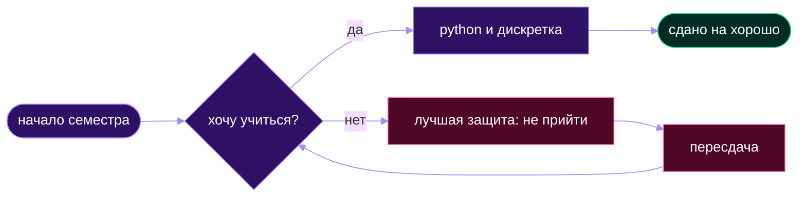

<div align="center">


[](https://t.me/kzntvaa)

</div>

# Алёна

---

## ~/about

Я **студентка ИТМО**, *1 курс*, направление _09.03.02_. Раньше ~~боялась~~ программирования, теперь разбираюсь.<br>Этот профиль сделан на паре по ИСРПО.

### config

```yaml
name: Алёна
university: ИТМО
direction: 09.03.02
year: 1
learning: [Python, Git]
```

---

## ~/favorite_code.py

```python
hobbies = ["гулять", "Роблокс", "английский"]

for hobby in hobbies:
    print(f"люблю {hobby}")
```

---

## ~/hobbies

**люблю:**

- гулять
- играть в Роблокс
- английский язык

**учу:**

+ Python
+ Git и GitHub
+ дискретную математику

**хочу полюбить:**

* алгоритмы
* ранние пары

---

## ~/courses

| предмет | что нравится | сложность |
|:--------|:------------:|----------:|
| **Python** | решать задачи |  |
| **Дискретка** | работать с множествами |  |
| **Алгосы** | ничего не нравится |  |

---

## ~/session.algorithm



---

## ~/goals

1. Освоить хотя бы 3 языка программирования
2. Разобраться с GitHub
3. Закрыть сессию без троек

---

## ~/quote.txt

> лучшая защита — не прийти

---

## ~/food.jpg


*том ям*

---

## ~/stats

<p align="center">
  
  
</p>

---

## ~/contacts

- telegram: [@kzntvaa](https://t.me/kzntvaa)


